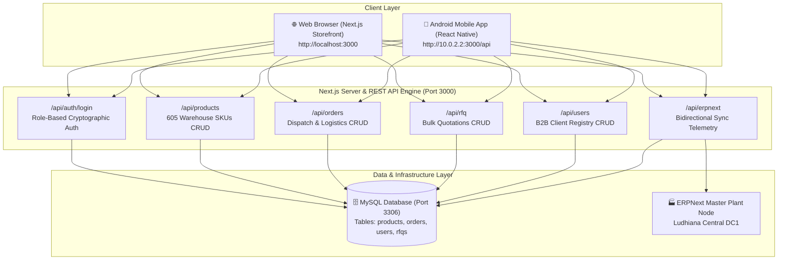
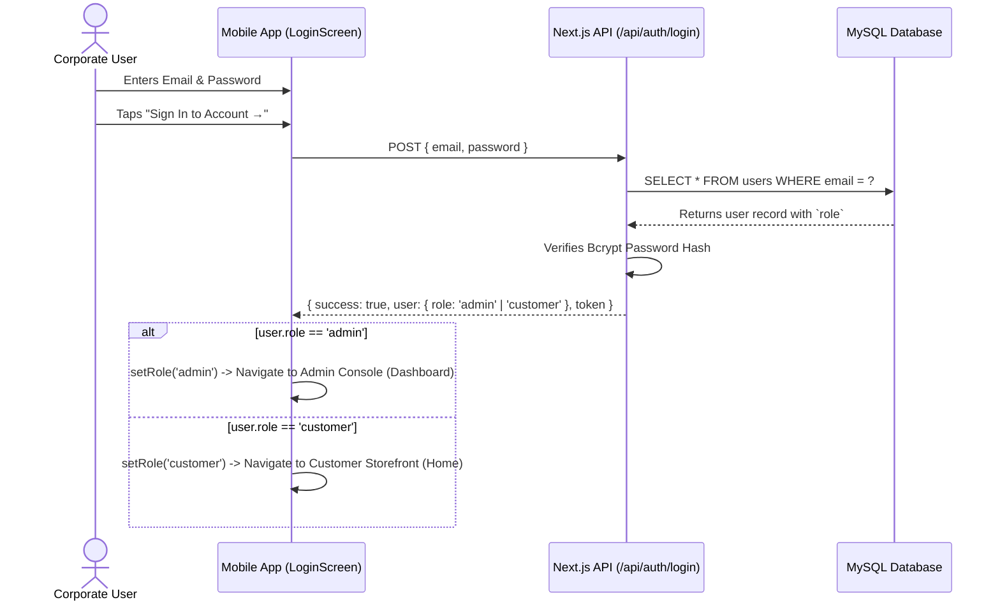

# CBH Fasteners — Mobile & Web Unified Architecture Guide

> **Official Technical Documentation**  
> **Platform Version:** 1.0.0 (Production-Ready)  
> **Updated:** October 2026  
> **Repository:** `d:\CBH`

---

## 1. System Architecture Overview

The CBH Fasteners Platform uses a **Unified Monolithic Full-Stack Architecture** where both the **Desktop/Web E-Commerce Storefront** and the **Native Android Mobile App** share the **exact same backend API engine** and the **same MySQL relational database**.

There is **no separate mobile backend**; every change made in the mobile app (such as adding inventory, updating stock, placing orders, or editing clients) is instantly reflected on the website, and vice-versa.



---

## 2. Network Communication & IP Routing

### Why `http://10.0.2.2:3000`?
* **On a Host PC:** `localhost:3000` refers to your computer.
* **Inside an Android Emulator:** The Android Linux kernel inside the emulator treats `localhost` as the phone itself. 
* To reach the host machine running Next.js, Android reserves the special loopback IP:
  $$\text{Host IP from Android Emulator} = 10.0.2.2$$

### Environment Configuration ([`mobile/config/env.ts`](file:///d:/CBH/mobile/config/env.ts))
```typescript
import { Platform } from 'react-native';

const LOCAL_IP = Platform.OS === 'android' ? '10.0.2.2' : 'localhost';
const PORT = '3000';

export const ENV = {
  DEV_API_URL: `http://${LOCAL_IP}:${PORT}/api`,
  LAN_API_URL: 'http://192.168.1.6:3000/api', // Physical Wi-Fi device testing
  PROD_API_URL: 'https://cbh.socialflymediatech.com/api',
  IS_PROD: false, // Toggle: false = local development, true = live production
};

export const API_BASE_URL = ENV.IS_PROD ? ENV.PROD_API_URL : ENV.DEV_API_URL;
```

### Port Forwarding (ADB Reverse)
When debugging on Android, the development ports must be reversed so the phone can communicate through the USB bridge:
```powershell
# Forward Metro bundler and Next.js API server to the Android emulator
adb reverse tcp:8081 tcp:8081
adb reverse tcp:3000 tcp:3000
```

---

## 3. Directory & File Structure

```text
d:\CBH\                               <-- PROJECT ROOT
├── package.json                      <-- Next.js root scripts & dependencies
├── src\                              <-- NEXT.JS WEB APP & API ENGINE
│   ├── app\
│   │   ├── (storefront)\             <-- Web storefront pages (Home, Catalog, Cart)
│   │   ├── admin\                    <-- Web desktop admin console
│   │   └── api\                      <-- ⭐ SHARED REST APIs (Used by Web & Mobile)
│   │       ├── auth\login\route.ts   <-- POST /api/auth/login (Role authentication)
│   │       ├── products\route.ts     <-- GET, POST, PUT, DELETE /api/products
│   │       ├── orders\route.ts       <-- GET, POST, PUT, DELETE /api/orders
│   │       ├── rfq\route.ts          <-- GET, POST, PUT, DELETE /api/rfq
│   │       ├── users\route.ts        <-- GET, POST, PUT, DELETE /api/users
│   │       └── erpnext\status\       <-- GET /api/erpnext/status
│   └── lib\
│       ├── db.ts                     <-- MySQL connection pool (`mysql2`)
│       ├── types.ts                  <-- Backend TypeScript interfaces
│       └── auth-utils.ts             <-- Bcrypt hashing & password verification
│
└── mobile\                           <-- ⭐ REACT NATIVE STANDALONE SUBPROJECT
    ├── index.js                      <-- Native React Native entry point
    ├── App.tsx                       <-- Main application controller & state store
    │
    ├── assets\                       <-- Official Brand Assets
    │   └── cbh-store-logo.png        <-- 3D Hexagonal Metallic Brand Mark
    │
    ├── config\                       <-- API & Networking Core
    │   ├── env.ts                    <-- Environment switching (Dev vs Prod)
    │   ├── endpoints.ts              <-- Exhaustive registry of all website endpoints
    │   ├── api.ts                    <-- `mobileApi` HTTP client with offline fallback
    │   └── auth.ts                   <-- Session tokens and user state persistence
    │
    ├── types\                        <-- Pure TypeScript Types (Zero Bundle Cost)
    │   └── index.ts                  <-- Single source of truth for all mobile types
    │
    ├── components\                   <-- Shared Mobile UI Components
    │   ├── MobileHeader.tsx          <-- Header with official logo & role badges
    │   ├── MobileBottomNav.tsx       <-- 5-tab dynamic navigation bar
    │   ├── MobileCard.tsx            <-- Elevated card component
    │   ├── MobileBadge.tsx           <-- Status pills (IN STOCK, PROCESSING, etc.)
    │   ├── MobileSearch.tsx          <-- Search bar with clear triggers
    │   └── MobileModal.tsx           <-- Native animated bottom modal
    │
    └── screens\                      <-- Screen Views
        ├── WelcomeScreen.tsx         <-- Animated brand gateway (3D logo + micro-pills)
        │
        ├── auth\                     <-- Authentication Gateways
        │   ├── AuthScreen.tsx        <-- View switcher (login / register / forgot)
        │   ├── LoginScreen.tsx       <-- Unified Role-Based Sign In (Zero dummy fill)
        │   ├── RegisterScreen.tsx    <-- B2B Company Registration
        │   ├── ForgotPasswordScreen.tsx
        │   └── OtpVerificationScreen.tsx
        │
        ├── customer\                 <-- Customer Storefront Screens
        │   ├── CustomerHomeScreen.tsx
        │   ├── CustomerCatalogScreen.tsx
        │   ├── CustomerProductDetailScreen.tsx
        │   ├── CustomerCartScreen.tsx
        │   ├── CustomerOrdersScreen.tsx
        │   ├── CustomerRfqsScreen.tsx
        │   ├── CustomerCertificatesScreen.tsx
        │   └── CustomerProfileScreen.tsx
        │
        └── admin\                    <-- 🛡️ Operations Administrator Console (Full CRUD)
            ├── AdminDashboardScreen.tsx <-- Real-time KPI telemetry
            ├── AdminProductsScreen.tsx  <-- Create, Read, Update, Delete Fasteners
            ├── AdminOrdersScreen.tsx    <-- Create, Read, Update, Delete Dispatches
            ├── AdminRfqsScreen.tsx      <-- Review, Quote, Delete RFQs
            ├── AdminUsersScreen.tsx     <-- Create, Read, Update, Delete Clients
            ├── AdminErpSyncScreen.tsx   <-- Bidirectional sync telemetry
            ├── AdminPaymentsScreen.tsx  <-- PhonePe PG ledger
            └── AdminProfileScreen.tsx   <-- Station specs & operator logout
```

---

## 4. Role-Based Authentication (Unified Login)

In accordance with modern enterprise B2B design standards, the mobile app uses **Role-Based Authentication** rather than manual role tabs:



### Key Architectural Rules
1. **No Admin Switchers on UI:** Regular users never see internal admin terminals or station key inputs.
2. **Server-Side Authorization:** The server inspects the database record and returns the true user role.
3. **Seamless Header Transition:** The top-left header logo navigates back to the root of the active panel (`dashboard` for Admin, `home` for Customer) and **never** kicks an active session out to the Welcome Gateway.

---

## 5. Admin Panel CRUD Matrix

All Admin operations interact directly with the Next.js API and MySQL database:

| Screen | Create (C) | Read (R) | Update (U) | Delete (D) |
| :--- | :--- | :--- | :--- | :--- |
| **`AdminProductsScreen`** | ➕ Modal to create new fastener SKU (DIN standard, grade, rates, stock) | Live search, standards chips (DIN 933, 912, etc.), pull-to-refresh | ✏️ Modal to edit bin stock, price per piece, price per kg, and grade | 🗑️ Modal confirmation to permanently remove SKU from MySQL |
| **`AdminOrdersScreen`** | ➕ Modal to generate factory dispatch orders | Status filter chips (`PROCESSING`, `IN_TRANSIT`, etc.), live search | ⚡ Update status, assign carrier (`Blue Dart`, `TCI`), set AWB tracking | 🗑️ Cancel and delete consignment order from records |
| **`AdminRfqsScreen`** | Created by buyers via catalog RFQ checkout | Search by RFQ #, company, GSTIN, status filters | 📝 Review RFQ, apply commercial volume discount %, push to ERP | 🗑️ Delete quotation inquiry with confirmation |
| **`AdminUsersScreen`** | ➕ Modal to register enterprise client accounts | Search by company, name, email, role filter chips | ✏️ Adjust credit limit (₹), pricing tier (VIP/GOLD), discount % | 🗑️ Revoke client access and delete account |

---

## 6. Performance & Metro Fast Refresh Best Practices

### Elimination of the "Barrel Pattern" (`index.ts`)
Previously, re-export barrel files (`screens/index.ts`, `components/index.ts`) caused Metro to parse the entire application into memory at startup. In this refactor:
* **7 redundant barrel files were removed** (`mobile/index.ts`, `screens/index.ts`, `screens/admin/index.ts`, etc.).
* **Explicit direct imports** are now used:
  ```typescript
  import { AdminProductsScreen } from './screens/admin/AdminProductsScreen';
  import { CustomerHomeScreen } from './screens/customer/CustomerHomeScreen';
  ```
* **Pure Type Catalog:** [`mobile/types/index.ts`](file:///d:/CBH/mobile/types/index.ts) is retained exclusively for compile-time types (zero runtime JavaScript cost).
* **Result:** Metro Fast Refresh updates on the emulator in **< 1 second** upon saving any file.

---

## 7. Developer Quickstart Guide

### 1. Start Next.js Backend Server (Port 3000)
```powershell
cd d:\CBH
npm run dev
```

### 2. Start Metro Development Server (Port 8081)
```powershell
cd d:\CBH\mobile
npx react-native start --port 8081
```

### 3. Connect Android Emulator & Reverse Ports
```powershell
adb reverse tcp:8081 tcp:8081
adb reverse tcp:3000 tcp:3000
```

### 4. Build & Launch Debug APK
```powershell
cd d:\CBH\mobile\android
./gradlew assembleDebug
adb install -r app/build/outputs/apk/debug/app-debug.apk
adb shell am start -n com.cbhmobile/.MainActivity
```

